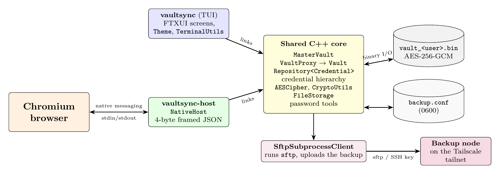
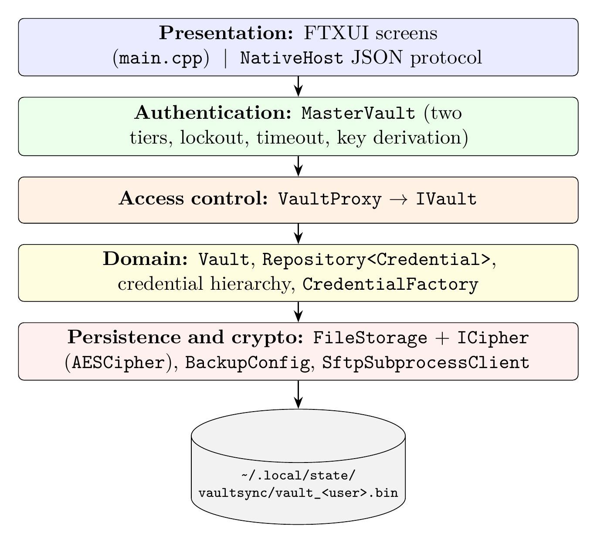

# VaultSync — Architecture

How the VaultSync programs fit together, and how the shared C++ code is layered.

---

## 1. System Components

VaultSync is three programs and one external link. All security logic lives in one shared C++ core that both executables link against.

- **`vaultsync`**: the interactive FTXUI terminal app the user works in.
- **`vaultsync-host`**: a headless native messaging host that Chrome starts on demand. It reads 4-byte length-prefixed JSON on `stdin` and replies on `stdout`.
- **VaultSync Autofill Companion**: a Manifest V3 extension. `content.js` detects login forms and autofills, `popup.html/js` unlocks, lists and locks, and `background.js` routes messages to the host.
- **Storage**: the encrypted vault file `vault_<user>.bin` (AES-256-GCM) and `backup.conf` (mode `0600`).
- **Off-site backup**: `SftpSubprocessClient` runs `sftp` with an SSH key and uploads the already-encrypted vault to a backup node over Tailscale.

---

## 2. Layered Core

Every request goes down through the layers in order. The front ends never touch the file system or the cipher directly, and nothing reaches the vault except through `VaultProxy`.

| Layer | Classes | Responsibility |
|---|---|---|
| Presentation | FTXUI screens (`main.cpp`), `NativeHost` | User input and the browser JSON protocol |
| Authentication | `MasterVault` | Two-tier passwords, lockout, auto-lock timeout, key derivation |
| Access control | `VaultProxy` → `IVault` | Rejects every call unless the session is unlocked |
| Domain | `Vault`, `Repository<Credential>`, credential hierarchy, `CredentialFactory` | Credentials and their operations |
| Persistence and crypto | `FileStorage`, `ICipher` (`AESCipher`), `BackupConfig`, `SftpSubprocessClient` | Encrypted binary I/O and off-site backup |

---

## 3. Browser Integration Flow

1. The extension calls `chrome.runtime.sendNativeMessage("com.vaultsync.native", ...)`.
2. Chrome reads the host manifest `com.vaultsync.native.json`, checks the extension ID against `allowed_origins`, and starts `/usr/bin/vaultsync-host`.
3. `NativeHost::readMessage()` reads the length-prefixed JSON (1 MB limit), and `handleMessage()` dispatches on `action`: `status`, `unlock`, `get_credentials`, `set_timeout`, `lock`.
4. The host calls the same `MasterVault` the terminal app uses and writes the reply with `writeMessage()`.

The `.tex` sources for these diagrams are in [docs/images/src/](docs/images/src/).

