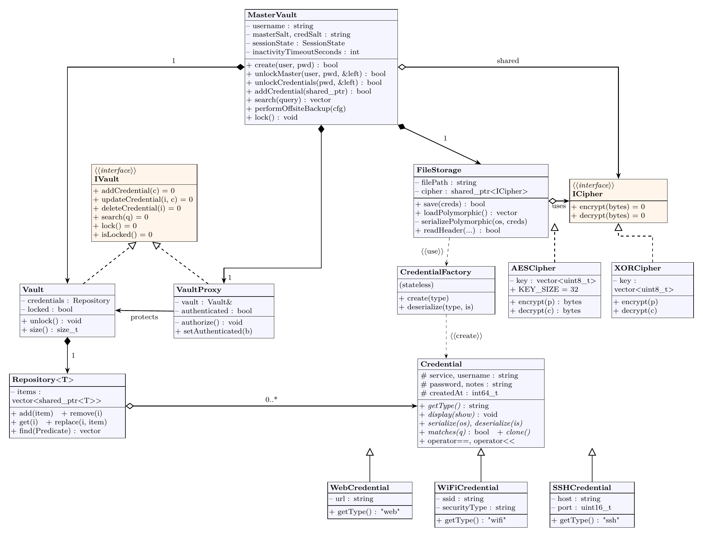
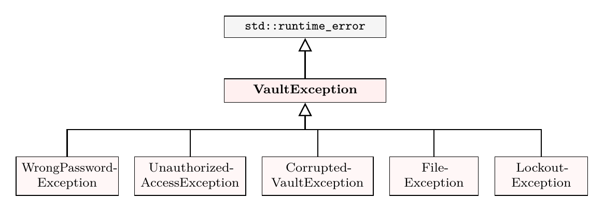

# VaultSync — Class Design

UML class diagrams of the shared C++ core and its exceptions. For the overall system and how the programs connect, see [architecture.md](architecture.md).

**Notation:** `+` public, `−` private, `#` protected · *italic* method = virtual · hollow triangle = inheritance · dashed line with hollow triangle = implements an interface · filled diamond = composition (owns) · hollow diamond = aggregation (shared) · dashed arrow = uses / creates

---

## 1. Core Domain

Credentials, the vault and its access control, storage and encryption.

- `Credential` is the abstract base for `WebCredential`, `WiFiCredential` and `SSHCredential`; `CredentialFactory` rebuilds the right subclass from a stored type tag when the vault is loaded.
- `MasterVault` owns the `Vault`, the `VaultProxy` and the `FileStorage`, and shares one `ICipher` with storage.
- `VaultProxy` and `Vault` both implement `IVault`; the proxy rejects every call unless the session is unlocked.
- `Vault` keeps its credentials in a generic `Repository<T>`.
- `AESCipher` and `XORCipher` implement `ICipher`, so the algorithm can change without touching `FileStorage`.

---

## 2. Browser Integration

`vaultsync-host` lets Chrome send JSON requests to the same `MasterVault` the terminal app uses, so the extension never touches the vault file directly.

---

## 3. Exception Hierarchy

Every VaultSync error derives from `VaultException`, so callers can catch one type or a specific failure.

---

## Design Patterns at a Glance

| Pattern | Where | Purpose |
|---|---|---|
| Protection Proxy | `VaultProxy` | Blocks every vault operation unless the session is unlocked |
| Strategy | `ICipher` → `AESCipher` / `XORCipher` | Swap the encryption algorithm without touching storage |
| Factory | `CredentialFactory` | Create the right credential subclass from a type tag |
| Prototype | `Credential::clone()` | Copy a credential without knowing its concrete type |
| Template | `Repository<T>` | Generic container reused for credentials |

The `.tex` sources for these diagrams are in [docs/images/src/](docs/images/src/).
