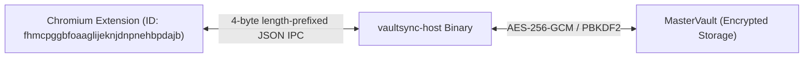

# VaultSync Native Messaging Host Registration Guide

This document describes how to register and unregister the **VaultSync Native Messaging Host** (`com.vaultsync.native`) on Linux for **Chromium** and **Google Chrome**.

---

## 1. Overview & Architecture

The VaultSync browser companion extension communicates with the native `vaultsync-host` binary via standard input/output (`stdin`/`stdout`) using length-prefixed JSON messages.



Chromium discovers native messaging hosts by looking for a JSON manifest named `<host-name>.json` (here: `com.vaultsync.native.json`) in well-defined directory locations.

### Host Metadata
* **Host Identifier:** `com.vaultsync.native`
* **Allowed Origin:** `chrome-extension://fhmcpggbfoaaglijeknjdnpnehbpdajb/`
* **Communication Type:** `stdio`

---

## 2. Directory Locations on Linux

### Per-User Registration (No root privileges required)
| Browser | Per-User Manifest Directory |
|:---|:---|
| **Chromium** | `~/.config/chromium/NativeMessagingHosts/` |
| **Google Chrome** | `~/.config/google-chrome/NativeMessagingHosts/` |

### System-Wide Registration (Requires `sudo` / package manager)
| Browser | System-Wide Manifest Directory |
|:---|:---|
| **Chromium** | `/etc/chromium/native-messaging-hosts/` |
| **Google Chrome** | `/etc/opt/chrome/native-messaging-hosts/` |

---

## 3. Quick Registration Using Helper Scripts

VaultSync provides robust helper scripts in `scripts/`:

### Per-User Registration (Recommended for Development & Local Installs)
```bash
# Auto-detect binary in build/ or system path and register for current user
./scripts/register_host.sh

# Or specify custom binary location:
./scripts/register_host.sh --binary /path/to/vaultsync-host

# Target specific browser:
./scripts/register_host.sh --browser chromium
./scripts/register_host.sh --browser chrome
```

### System-Wide Registration
```bash
# Must be executed as root
sudo ./scripts/register_host.sh --system --binary /usr/bin/vaultsync-host
```

### Unregistration
```bash
# Remove per-user registration
./scripts/unregister_host.sh

# Remove system-wide registration (as root)
sudo ./scripts/unregister_host.sh --system
```

The unregistration script verifies that the manifest contains `"com.vaultsync.native"` before deletion, ensuring no third-party native messaging hosts are removed.

---

## 4. CMake & Packaging Integration

### Relocatable Installation
When building and installing via CMake:
```bash
cmake -B build -S . -DCMAKE_INSTALL_PREFIX=/usr
cmake --build build -j4
sudo cmake --install build
```
This installs:
* `vaultsync` and `vaultsync-host` into `${CMAKE_INSTALL_BINDIR}` (`/usr/bin`)
* Relocatable manifest into `${CMAKE_INSTALL_DATADIR}/vaultsync/com.vaultsync.native.json`
* Helper scripts `register_host.sh` and `unregister_host.sh` into `${CMAKE_INSTALL_BINDIR}`

### Optional System-Wide Manifest Installation
To install the manifest directly into `/etc/chromium/` and `/etc/opt/chrome/` during `cmake --install`:
```bash
cmake -B build -S . -DINSTALL_SYSTEM_NATIVE_HOST_MANIFEST=ON
sudo cmake --install build
```

---

## 5. Verification & Testing

1. Verify JSON syntax and origin:
   ```bash
   cat ~/.config/chromium/NativeMessagingHosts/com.vaultsync.native.json
   ```
2. Verify the native host unit tests pass:
   ```bash
   ./build/test_native_host
   ```
3. Load the unpacked extension in Chromium:
   * Open `chrome://extensions`
   * Enable **Developer mode**
   * Click **Load unpacked** and select the `extension/` directory
   * Confirm the Extension ID is `fhmcpggbfoaaglijeknjdnpnehbpdajb`
